<picture>
  <source media="(prefers-color-scheme: dark)" srcset="./assets/hero-dark.svg">
  <source media="(prefers-color-scheme: light)" srcset="./assets/hero-light.svg">
  
</picture>

<a href="https://github.com/Nirlepb">
<picture>
  <source media="(prefers-color-scheme: dark)" srcset="https://readme-typing-svg.demolab.com?font=JetBrains+Mono&weight=500&size=20&duration=2800&pause=900&color=A78BFA&center=true&vCenter=true&width=640&lines=Turning+coffee+into+code+%E2%98%95;Building+with+Java+%2B+AI;Always+shipping+something+new+%F0%9F%9A%80">
  <source media="(prefers-color-scheme: light)" srcset="https://readme-typing-svg.demolab.com?font=JetBrains+Mono&weight=500&size=20&duration=2800&pause=900&color=7C3AED&center=true&vCenter=true&width=640&lines=Turning+coffee+into+code+%E2%98%95;Building+with+Java+%2B+AI;Always+shipping+something+new+%F0%9F%9A%80">
  
</picture>
</a>

 

  

<picture>
  <source media="(prefers-color-scheme: dark)" srcset="./assets/divider.svg">
  <source media="(prefers-color-scheme: light)" srcset="./assets/divider.svg">
  
</picture>

## whoami

<picture>
  <source media="(prefers-color-scheme: dark)" srcset="./assets/about-dark.svg">
  <source media="(prefers-color-scheme: light)" srcset="./assets/about-light.svg">
  
</picture>

<table align="center">
<tr>
<td align="center" width="180">🔭 <b>Now</b> Java + AI projects</td>
<td align="center" width="180">🧠 <b>Sharpening</b> Data structures &amp; algorithms</td>
<td align="center" width="180">🌱 <b>Learning</b> Spring Boot &amp; ML</td>
<td align="center" width="180">💬 <b>Ask me about</b> Java, Python, DSA</td>
</tr>
</table>

<picture>
  <source media="(prefers-color-scheme: dark)" srcset="./assets/divider.svg">
  <source media="(prefers-color-scheme: light)" srcset="./assets/divider.svg">
  
</picture>

## Tech stack

<picture>
  <source media="(prefers-color-scheme: dark)" srcset="./assets/divider.svg">
  <source media="(prefers-color-scheme: light)" srcset="./assets/divider.svg">
  
</picture>

## GitHub stats

<picture>
  <source media="(prefers-color-scheme: dark)" srcset="./assets/stats-dark.svg">
  <source media="(prefers-color-scheme: light)" srcset="./assets/stats-light.svg">
  
</picture>

 

<picture>
  <source media="(prefers-color-scheme: dark)" srcset="./assets/heatmap-dark.svg">
  <source media="(prefers-color-scheme: light)" srcset="./assets/heatmap-light.svg">
  
</picture>

<picture>
  <source media="(prefers-color-scheme: dark)" srcset="./assets/divider.svg">
  <source media="(prefers-color-scheme: light)" srcset="./assets/divider.svg">
  
</picture>

## Contribution snake

<picture>
  <source media="(prefers-color-scheme: dark)" srcset="https://raw.githubusercontent.com/Nirlepb/Nirlepb/output/github-snake-dark.svg">
  <source media="(prefers-color-scheme: light)" srcset="https://raw.githubusercontent.com/Nirlepb/Nirlepb/output/github-snake.svg">
  
</picture>

<picture>
  <source media="(prefers-color-scheme: dark)" srcset="./assets/divider.svg">
  <source media="(prefers-color-scheme: light)" srcset="./assets/divider.svg">
  
</picture>

  

<i>First, solve the problem. Then, write the code.</i>

 

<picture>
  <source media="(prefers-color-scheme: dark)" srcset="./assets/footer-dark.svg">
  <source media="(prefers-color-scheme: light)" srcset="./assets/footer-light.svg">
  
</picture>

